# Electric Go-Kart Design in SolidWorks

An electric go-kart modelled part by part in SolidWorks: tubular frame, double wishbone front suspension, rack and pinion steering, chain-driven solid rear axle, 60 V motor and battery pack, seat and driver envelope.

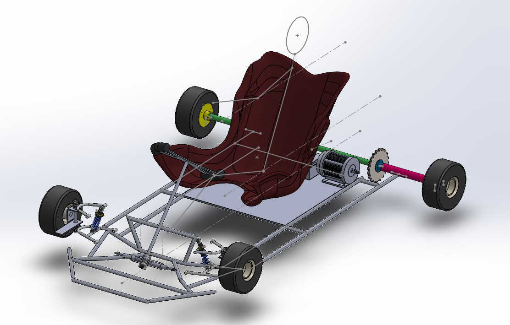

> **What the CAD files are.** The pictures in this README show the final design, taken from the coursework report. The final assembly file and the final frame part could not be recovered. The CAD in this repo is an earlier snapshot of the vehicle assembly (9 November 2023) plus every individual part and sub-assembly, including the ones added to the vehicle after that date. See [What Is and Is Not in the CAD](#what-is-and-is-not-in-the-cad).

## Design Problem

A go-kart is a compact vehicle, but it still needs every core subsystem of a car: a frame, suspension, steering, a drivetrain, a power source and a driver position. Each one has to be modelled as real parts and then fit together in a single assembly without clashing. The task was to take a go-kart from individual components to a full vehicle layout in CAD.

## Project Objective

- Model the components of an electric go-kart in SolidWorks, using instructor-provided models for the motor, battery and seat.
- Build each subsystem as its own sub-assembly with working mates.
- Combine the sub-assemblies into one full-vehicle assembly and arrange the components around the driver.

## Specifications

All values below are taken from the model files and dimension views in this repo. The frame row describes the final frame, whose part file is not in the repo.

| Item | Value | Source |
|---|---|---|
| Motor | DC, 60 V, 2200 W, 4000 rpm | Instructor-provided model (not included) |
| Battery pack | 5 x 12 V 12 Ah in series, 60 V nominal | Report and instructor-provided model (not included) |
| Frame (final design) | Circular tube, about 1450 mm main rail length, 1100 mm rear width, 500 mm front width | [frame dimensions](images/frame-dimensions.png), from the report |
| Front suspension | Double wishbone with coil-over shock absorbers | `cad/go-kart/double wishbone assembly/` |
| Steering | Rack and pinion with ball joints | `cad/go-kart/rack pinion and steering wheel/` |
| Final drive | Chain and sprocket to a solid rear axle | `cad/go-kart/rear axle assembly/`, `cad/go-kart/chain/` |
| Wheel rim | 114.3 mm wide, 63.5 mm radius at the lip | [wheel dimensions](images/wheel-dimensions.png) |

## Design Approach

The kart was built bottom-up over one semester: parts first, then sub-assemblies, then the full vehicle.

### Frame

**The final frame is a welded tube structure built with the SolidWorks Weldments tool.** A sketch defines the centrelines and a circular pipe profile is applied along them. The overall layout follows a go-kart chassis from a published paper (see Acknowledgements).

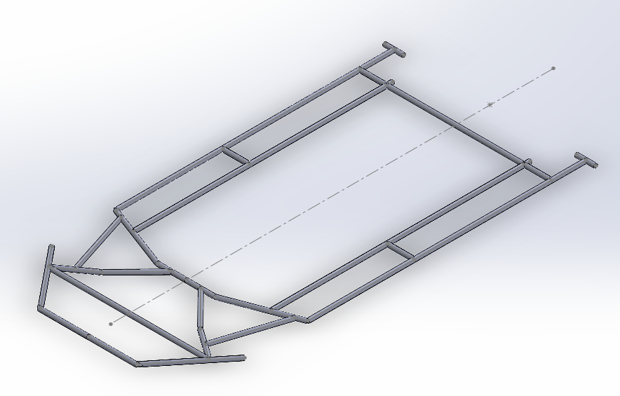

The frame part in this repo (`cad/go-kart/chassis.SLDPRT`) is the earlier rectangular version used while the components were being arranged. The tapered frame pictured above replaced it later.

### Front suspension

**The front end uses a double wishbone layout with a coil-over shock on each side.** Each corner is made of an upper A-arm, a lower A-arm with shock mounts, and a shock absorber assembly (spring, top rod, base and adjuster nut). The stub axle turns on a king pin carried between the arms.

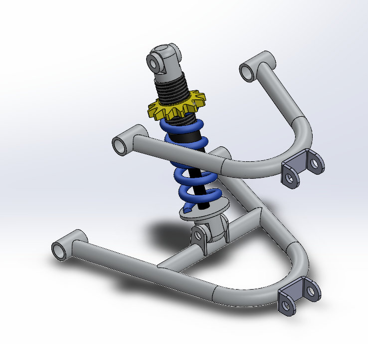

| Shock absorber | Upper A-arm | Lower A-arm |
|---|---|---|
| 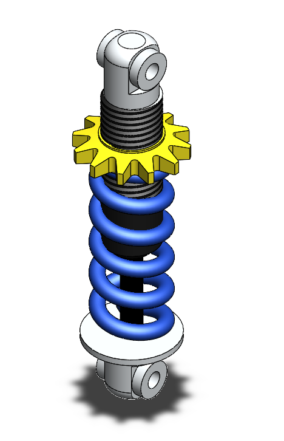 | 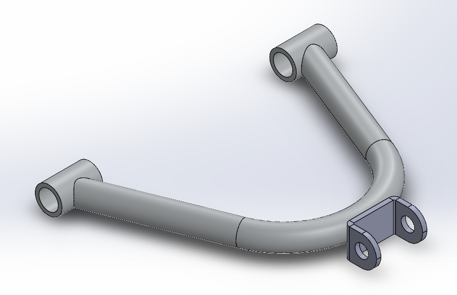 | 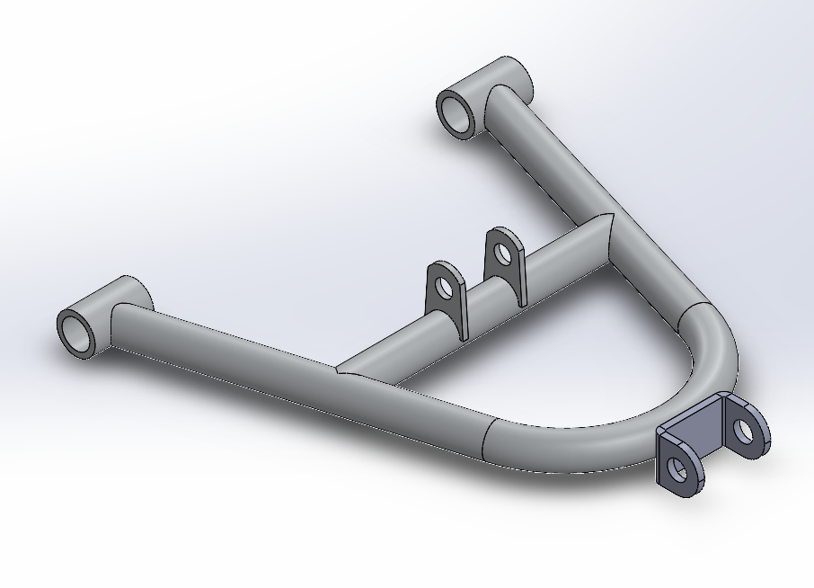 |

### Steering

**Steering is by rack and pinion, driven directly from the steering column.** The steering wheel shape was inspired by a Paramount Browns kart steering wheel and modelled from scratch.

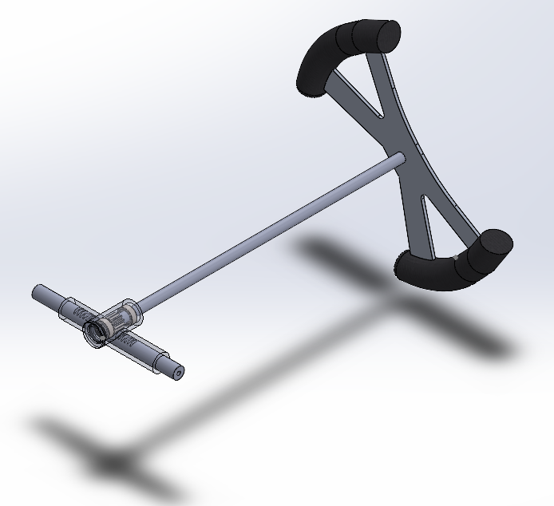

### Rear axle and drivetrain

**Drive goes from the motor through a chain to a sprocket on a solid rear axle, which turns both rear wheels together.** The axle carries two sprocket flanges and a spacer, with keyways for the hubs.

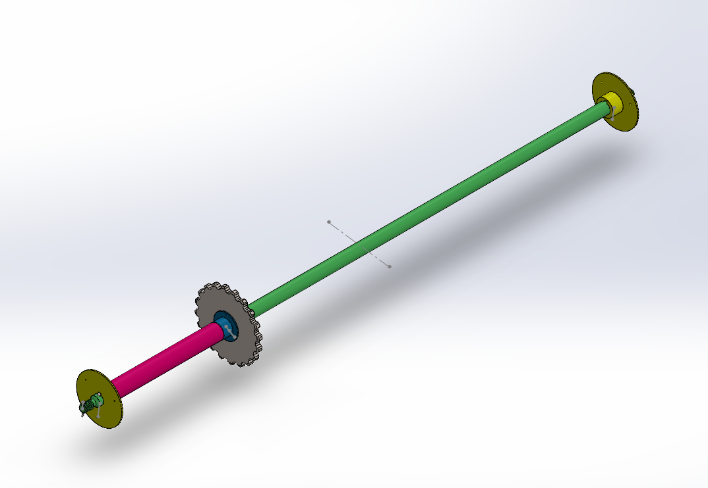

### Wheels and tyres

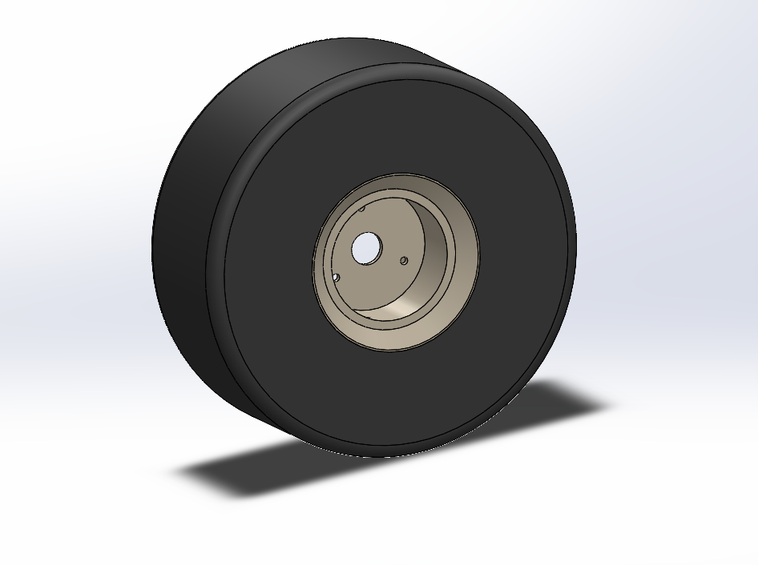

### Motor, battery and seat (provided models)

| Motor | Battery | Seat |
|---|---|---|
| 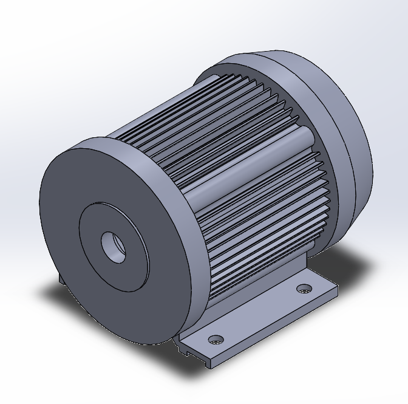 | 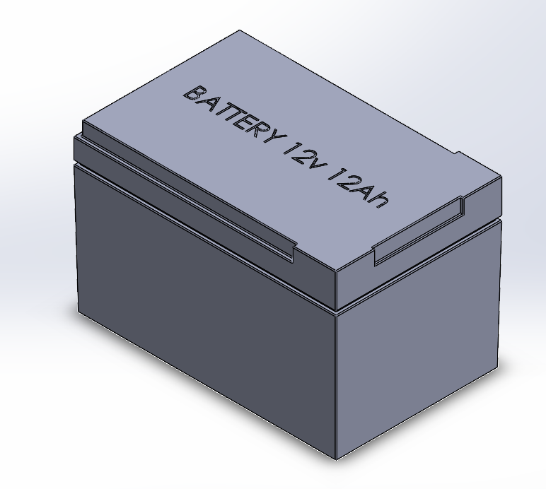 | 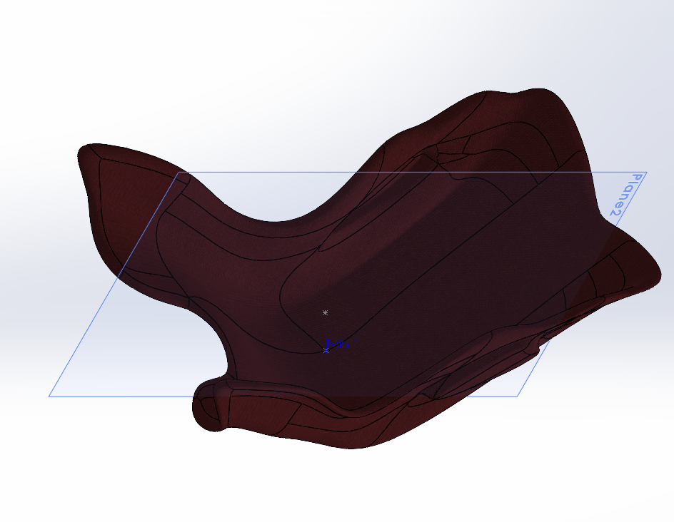 |

The motor, battery and seat models were provided by the course instructor and are not the author's own work. They are shown here as pictures only; their CAD files are not included in this repo. In the assembly the seat is paired with a simple driver envelope (`driver dimension.SLDPRT`) so the steering wheel and pedal area could be placed around a seated driver.

## Final Design

| Front | Back |
|---|---|
| 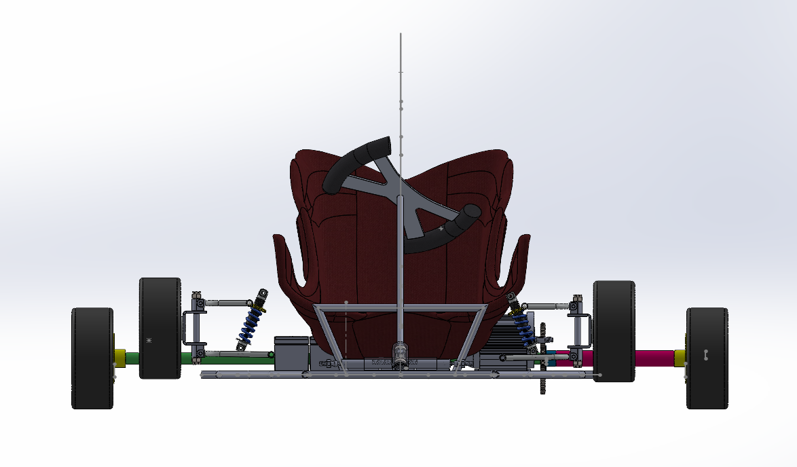 | 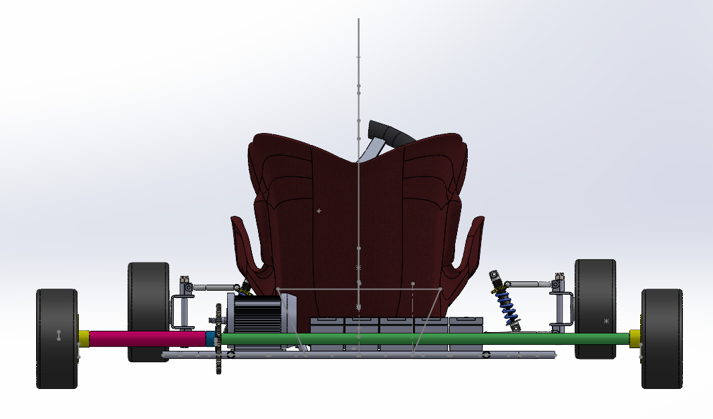 |

| Side | Side |
|---|---|
| 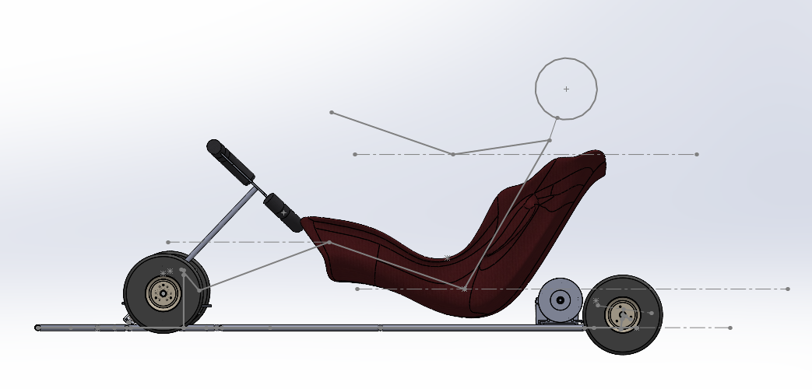 | 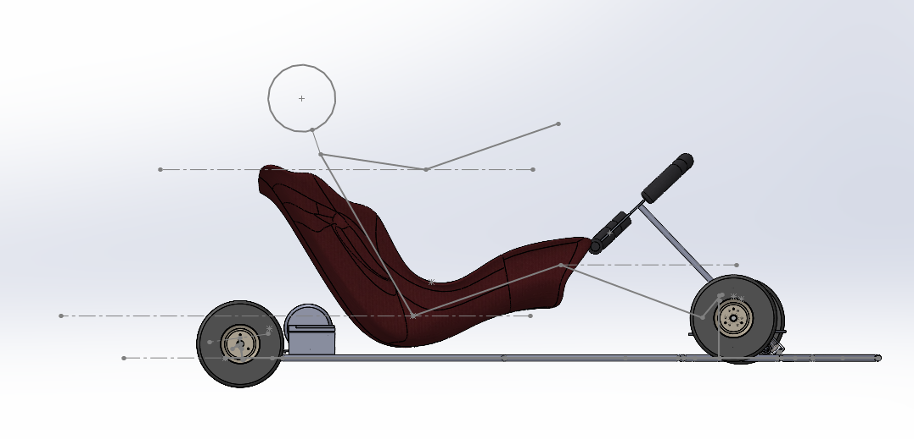 |

## What Is and Is Not in the CAD

| | In the vehicle assembly | Separate files only | Not in the repo |
|---|---|---|---|
| Frame | Earlier rectangular frame | | Final tapered frame |
| Driver envelope | Yes | | |
| Seat | | | Instructor-provided model, pictures only |
| Front suspension, front axles, front wheels | Yes | | |
| Rack and pinion | Yes | | |
| Rear axle with sprocket flanges | Yes | | |
| Steering wheel | | Yes | |
| Chain | | Yes | |
| Motor, battery | | | Instructor-provided models, pictures only |
| Rear wheels | | Yes (same wheel and tyre assembly as the front) | |
| Standard parts (bearings, chain sprocket, nuts, keys) | | | SolidWorks Toolbox parts, not saved with the project |
| Final full-vehicle assembly | | | Yes |

`cad/step/go-kart.step` is the vehicle assembly snapshot exported to STEP so it can be viewed without SolidWorks. It contains the same components as the first column, so it has no seat.

## Limitations

- **Final assembly not available.** The CAD is an earlier snapshot, as set out above. The final design exists here only as images and in the report.

- **Geometry only.** No stress analysis, motion study or mass calculation was run, so the design has not been checked for strength, stiffness or performance.
- **No sizing calculations.** The motor, battery and gearing were chosen as reasonable values and not sized from a target speed, range or acceleration.
- **No manufacturing drawings.** There are no dimensioned drawings, tolerances, weld details or bill of materials.
- **Simplified parts.** The chain and tyres are envelope models without internal detail. Brakes, pedals and wiring are not modelled.
- **Not built.** The kart exists only in CAD.

## Tools Used

- SolidWorks: part modelling, weldments, surfacing, assemblies and mates

## Repository Structure

```
solidworks-go-kart-design/
  README.md
  cad/
    go-kart/      vehicle assembly snapshot (component rearrangement.SLDASM) plus one folder per subsystem
    gearbox/      separate gearbox assembly from the same module (not part of the kart)
    step/         go-kart.step, the vehicle assembly snapshot in a neutral format
  images/         renders and dimension views of the final design, from the report
  docs/           original coursework report (PDF)
  .gitignore
```

## How to Open

1. Download the repo (Code, Download ZIP) and unzip it.
2. **Without SolidWorks:** open `cad/step/go-kart.step` in any CAD program or free STEP viewer.
3. **With SolidWorks:** open `cad/go-kart/component rearrangement.SLDASM`. Keep the folder structure as it is so the assembly can find its parts. SolidWorks will report `car seat.SLDPRT` as missing (it is not included) and the Toolbox parts as missing unless the Toolbox add-in is installed. Choose to suppress or skip them.
4. The files were saved in 2023. SolidWorks cannot open files saved in a newer release than the one installed.

## Key Takeaways

- Building bottom-up keeps each sub-assembly testable on its own before it goes into the vehicle.
- Weldments make a tube frame quick to change: edit the 3D sketch and every member updates.
- Placing a driver envelope early shows packaging problems before the detail work is done.

## Author

Pruek Lergchinnaboot, BEng Mechanical Engineering, Kasetsart University. All parts were modelled by the author except the motor, battery and seat, which were provided by the course instructor.

## Acknowledgements

- Motor, battery and seat models provided by the course instructor. Their CAD files are not included.
- Frame layout adapted from a chassis dimension figure in a published go-kart design paper. The original source could not be traced when this repo was prepared.
- Steering wheel shape inspired by a Paramount Browns kart steering wheel.

## Revision Note

This was coursework for the Mechanical Design Process (MDP) module, Department of Mechanical Engineering, Kasetsart University, completed August to December 2023. Marks have been released.

The report in `docs/` is the report as submitted, with the student ID removed. The CAD files are an earlier snapshot than the design shown in the report, because the final assembly could not be recovered. This README was written afterwards and corrects it in three places: the battery pack is 60 V (five 12 V batteries in series), not 40 to 50 V; the rear axle is a chain-driven solid axle, not a propeller shaft; and the semester on the report cover should read August to December 2023. The README was prepared with AI assistance.
